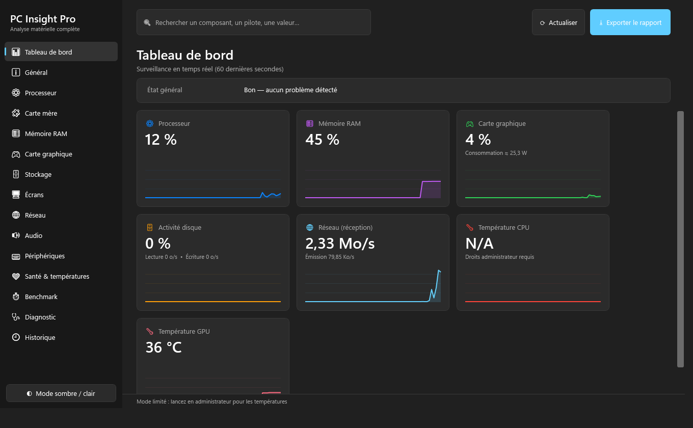
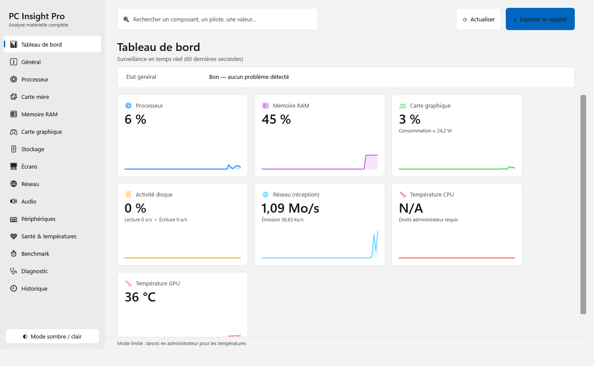
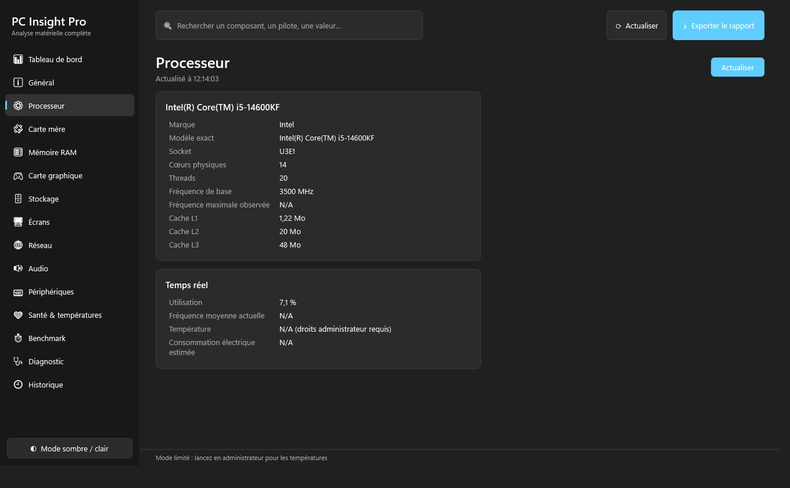
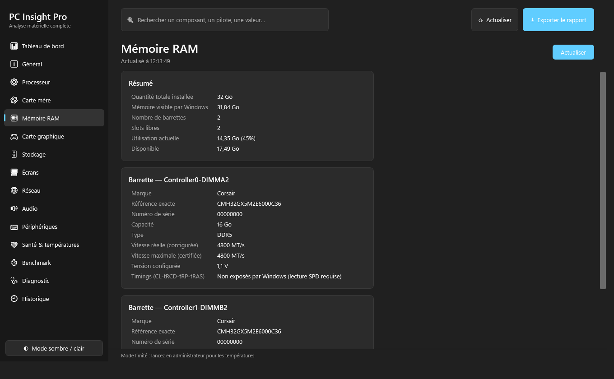
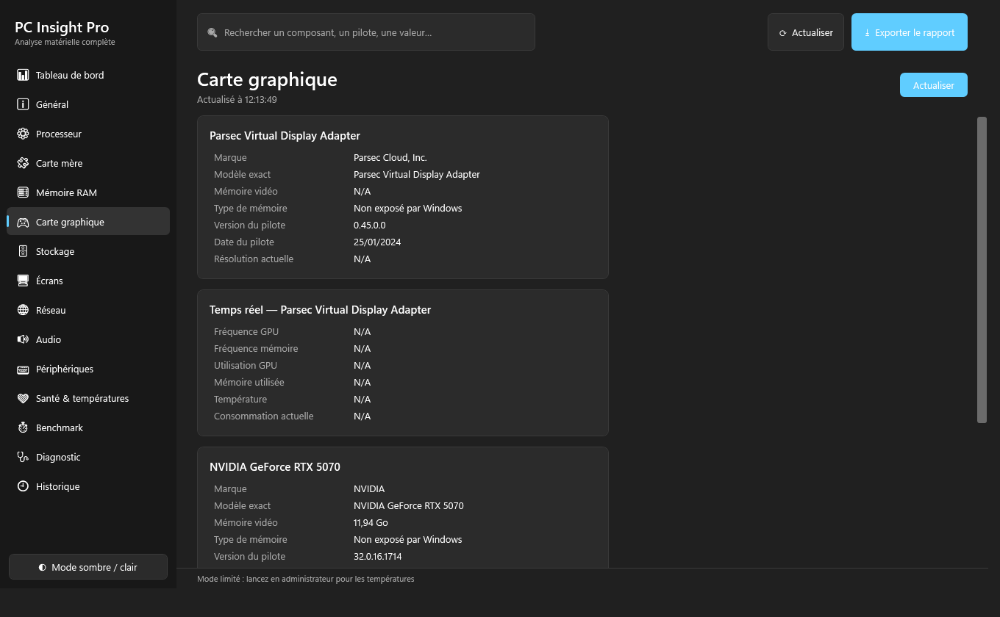
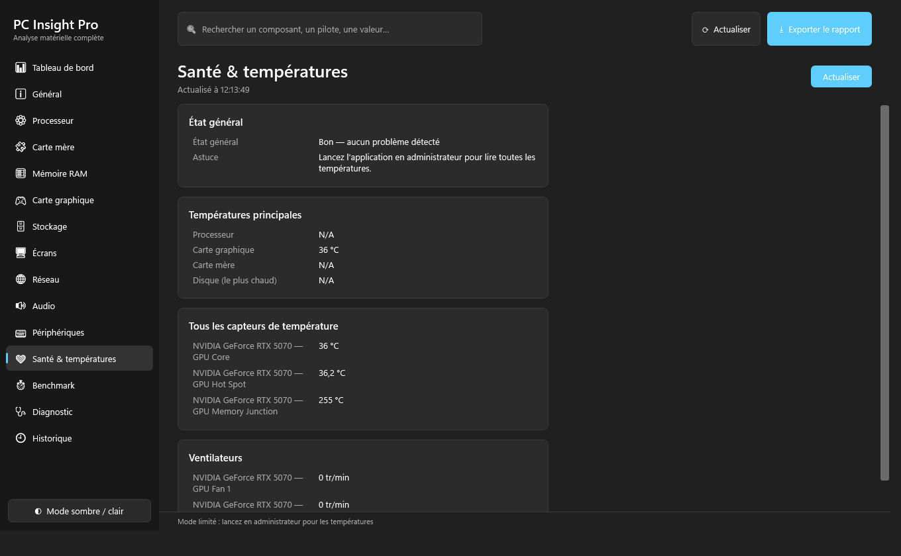
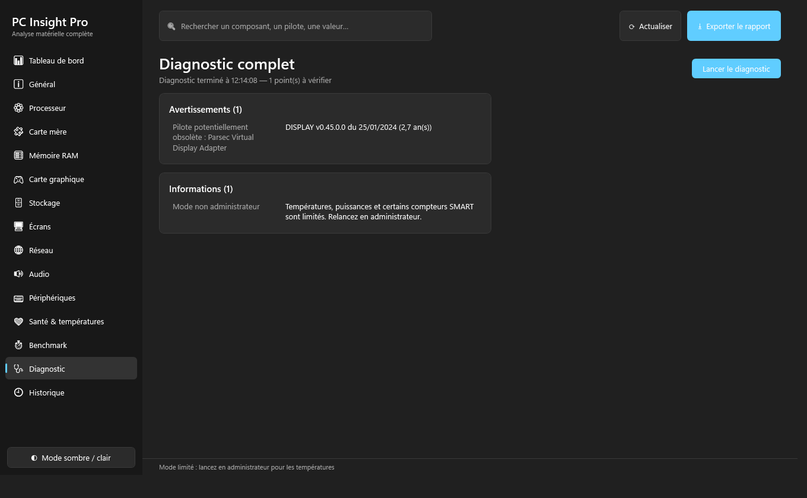
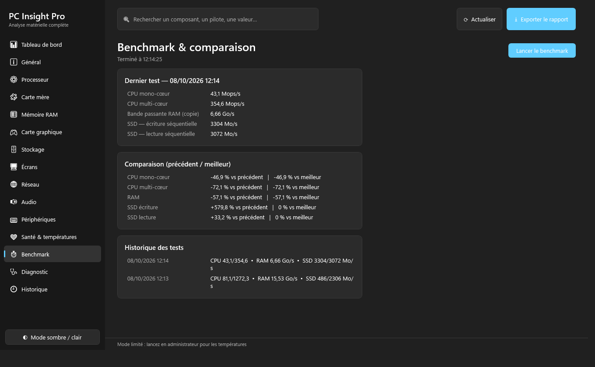

<h1 align="center">PC Insight Pro</h1>

<b>Analysez entièrement votre PC Windows : matériel, pilotes, températures, santé — en temps réel.</b>

  

## Télécharger

➡️ **[Dernière version — PCInsightPro_Setup_1.0.0.exe](../../releases/latest)** (Windows 10 / 11, 64 bits, .NET inclus : rien d'autre à installer)

> Lancez l'application **en administrateur** pour afficher les températures, la consommation et les compteurs SMART complets. Sans ces droits, ces valeurs apparaissent « N/A » (limitation de Windows, visible sur les captures ci-dessous).
> L'installateur n'est pas signé : Windows SmartScreen peut afficher un avertissement au premier lancement.

## Fonctionnalités

| | |
|---|---|
| 🖥 **Inventaire complet** | Général, processeur, carte mère, RAM (barrette par barrette), GPU, stockage, écrans, réseau / Wi-Fi, audio, périphériques |
| 📊 **Tableau de bord temps réel** | CPU, RAM, GPU, disque, réseau, températures — courbes sur 60 secondes |
| ❤ **Santé du matériel** | Alertes de surchauffe, état SMART, usure SSD |
| 🩺 **Diagnostic** | Détection de problèmes (disque plein, périphériques en erreur, pilotes anciens, panne SMART prévue) |
| ⏱ **Benchmark rapide** | CPU mono/multi-cœur, bande passante RAM, SSD séquentiel, comparaison avec les tests précédents |
| 🕘 **Historique matériel** | Détection automatique des changements de configuration d'un lancement à l'autre |
| 🔍 **Recherche instantanée** | Retrouvez n'importe quelle valeur dans toutes les rubriques |
| ⭳ **Export** | PDF, HTML, CSV, JSON, TXT — aussi en ligne de commande : `PCInsightPro.exe --export rapport.pdf` |
| 🎨 **Interface Windows 11** | Mode clair / sombre, navigation latérale, démarrage rapide, faible empreinte mémoire (≈ 60 Mo) |

## Aperçu

<table>
  <tr>
    <td> Tableau de bord — mode clair</td>
    <td> Processeur</td>
  </tr>
  <tr>
    <td> Mémoire RAM, barrette par barrette</td>
    <td> Carte graphique</td>
  </tr>
  <tr>
    <td> Santé &amp; températures</td>
    <td> Diagnostic complet</td>
  </tr>
  <tr>
    <td colspan="2"> Benchmark &amp; historique des tests</td>
  </tr>
</table>

## Limites connues

Certaines informations ne sont tout simplement pas fournies par Windows et sont indiquées comme telles plutôt qu'inventées : timings RAM, type de mémoire vidéo, technologie de dalle (IPS / VA / OLED), génération PCIe négociée. La détection de « pilotes obsolètes » se base sur la date du pilote installé, sans comparaison avec les sites des constructeurs.

## Technique

C# · .NET · WPF · MVVM — WMI et LibreHardwareMonitor pour les mesures, PDFsharp pour l'export PDF. Les données (journaux, historique, préférences) sont stockées dans `%LocalAppData%\PCInsightPro`.

*Le code source n'est pas publié dans ce dépôt ; seul l'installateur est distribué via les Releases.*
